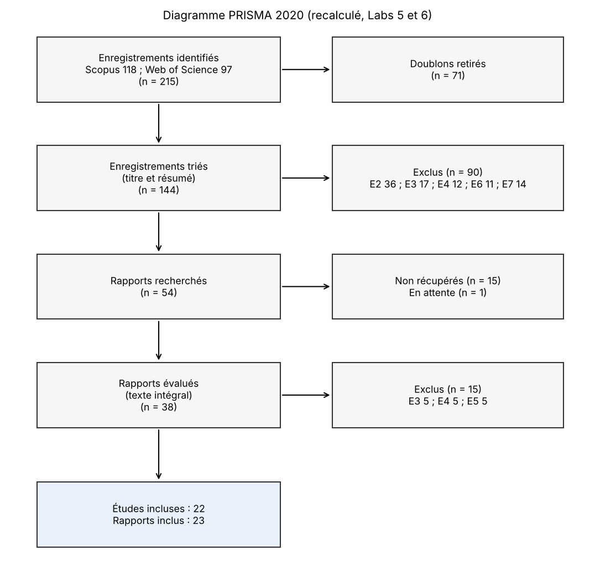

# Lab 6 — Screening des titres, résumés et textes intégraux

**Revue systématique :** *Machine learning and remote sensing for disease and stress detection in olive* (PRISMA 2020)
**Entrée :** les 144 références uniques du Lab 5 (Scopus + Web of Science, recherche du 15/11/2026)
**Résultat :** 144 triées → 90 exclues sur titre/résumé → 54 rapports recherchés → 38 évalués sur texte intégral → **23 rapports inclus, 22 études**


## En bref

**Technologies.** **Python 3** avec pandas (tableaux), openpyxl (grilles Excel), PyMuPDF (texte des PDF), matplotlib (diagramme PRISMA) et `unittest` (tests). Le kappa de Cohen est calculé par une fonction écrite dans le script et vérifié avec scikit-learn. Le lab ne demande **pas de SQL**.

**D'où viennent les décisions.** Le pré-screening automatique (étape 6) est produit par le script. Les **décisions finales sont humaines** : ce sont celles prises par l'évaluatrice pendant la SLR, consignées dans le tableau de tri `data/Screening_ledger_olive_PRISMA2020.csv` et rattachées ici aux identifiants du Lab 5. Le script ne remplace pas la lecture ; il pré-remplit la grille, mesure l'accord et calcule les chiffres PRISMA.

**Résultats clés**

| Mesure | Valeur |
|---|---|
| Références triées | 144 |
| Exclues sur titre/résumé | 90 : E2 36, E3 17, E7 14, E4 12, E6 11 |
| Accord du double tri | 124/143 (86,7 %), **kappa = 0,695** (accord substantiel) |
| Désaccords résolus | 19, tous tranchés et documentés |
| Textes intégraux recherchés / non récupérés / en attente | 54 / 15 / 1 |
| Exclus sur texte intégral | 15 : E3 5, E4 5, E5 5 |
| Inclus | **23 rapports, 22 études** |
| Pré-screening automatique contre décision humaine | accord 75 %, kappa 0,51 ; 21 des 23 inclus retenus |

**Correspondance étapes → fichiers**

| Étape du lab | Section | Fichiers |
|---|---|---|
| 1 Introduction | §1 | `README.md` |
| 2 Environnement | §2 | `requirements.txt` |
| 3 Chargement du dataset du Lab 5 | §3 | `data/dataset_lab5_public.csv`, `scripts/screening.py` (`load_dataset`) |
| 4 Critères d'inclusion/exclusion | §4 | `config/criteres.json`, `tests/test_criteres.py` |
| 5 Grille de screening | §5 | `output/05_grille_screening_titres.xlsx` |
| 6 Screening automatisé | §6 | `scripts/screening.py` (`auto_screen`), `output/06_grille_preremplie.xlsx`, `output/06_eval_script_vs_humain.csv` |
| 7 Classement et motifs | §7 | `output/07_decisions_titre_resume.csv` |
| 8 Double screening et accord | §8 | `output/08_accord.json`, `output/08_desaccords.csv`, `output/08_log_resolutions.txt` |
| 9 Export pour les textes intégraux | §9 | `output/09_liste_textes_integraux.csv` |
| 10 Screening des textes intégraux | §10 | `scripts/fulltext_screening.py`, `output/10_decisions_texte_integral.csv` |
| 11 Motifs et diagramme PRISMA | §11 | `output/11_tableau_maitre.csv`, `output/11_prisma.json`, `output/11_diagramme_prisma.png` |
| 12 Conclusion, vérification et défis | §12 | `verifications.txt`, `scripts/defi_simule.py`, `data/exemple_simule.csv`, `output/12_defi_simule_resultats.csv` |

**Exécuter**

```bash
python -m venv venv && venv\Scripts\activate        # Windows (Linux/macOS : source venv/bin/activate)
pip install -r requirements.txt
python scripts/screening.py                         # étapes 3 à 9 et 11
python scripts/fulltext_screening.py                # étape 10 : aide sur les PDF placés dans pdfs/
python scripts/defi_simule.py                       # défi 1 : 10 références simulées
python -m unittest discover -s tests -t . -v        # 21 tests
```

**Tests** (21, sans les résumés ni les PDF) :
- `test_criteres.py` : chaque critère E1 à E8, la règle « un seul code, le premier non rempli », les cas incertains, la recherche de mots courts, le pourcentage d'accord et le kappa (exemple classique à 0,40, cas parfait, cas du hasard, comparaison avec scikit-learn) ;
- `test_defis_et_texte_integral.py` : le défi 1 (10/10 conformes) et l'extraction de texte sur des PDF générés pendant le test ;
- `test_resultats_publies.py` : chaque référence du Lab 5 a une décision, l'arithmétique du diagramme PRISMA, les chiffres de la SLR, le recalcul de l'accord et du kappa, la résolution des 19 désaccords, l'absence de résumés dans les fichiers publiés.

Ils sont exécutés automatiquement par GitHub Actions à chaque envoi.

## Contenu du dépôt

| Dossier | Contenu |
|---|---|
| `config/` | `criteres.json` : les 8 critères du protocole et les mots-clés du pré-screening |
| `data/` | dataset du Lab 5 (sans résumés), tableau de tri de la SLR, décision complémentaire pour la référence récupérée au Lab 5, références simulées du défi |
| `scripts/` | `screening.py` (étapes 3 à 9 et 11), `fulltext_screening.py` (étape 10), `defi_simule.py` (défi 1) |
| `output/` | grilles, décisions, accord, désaccords, liste des textes intégraux, tableau maître, chiffres et diagramme PRISMA |
| `tests/` | 21 tests automatiques |
| `local/`, `pdfs/` | résumés et PDF, à garder en local (droits des bases et des éditeurs ; exclus par `.gitignore`) |
| `verifications.txt` | réponses aux trois questions et aux deux défis, demandé par l'énoncé |

---

## 1. Introduction et prérequis

Le screening applique les critères d'éligibilité du protocole en deux temps : d'abord sur le titre et le résumé, puis sur le texte intégral des références retenues. Chaque décision est classée **Inclure / Exclure / Incertain**, chaque exclusion reçoit **un seul motif**, et l'accord entre deux passages est mesuré. Les chiffres obtenus alimentent le diagramme PRISMA 2020.

Flux suivi : références uniques (Lab 5) → titre et résumé → décision → récupération des textes intégraux → screening complet → diagramme PRISMA.

## 2. Préparer l'environnement de travail

Environnement virtuel et dépendances : voir « Exécuter » ci-dessus. `requirements.txt` ajoute aux bibliothèques de l'énoncé (pandas, numpy, openpyxl) PyMuPDF pour l'étape 10, matplotlib pour le diagramme et scikit-learn pour vérifier le kappa.

## 3. Charger le dataset dédupliqué du Lab 5

`scripts/screening.py` lit `data/dataset_lab5_public.csv`, la sortie du Lab 5 : **144 références** (et non 780 comme dans l'exemple de l'énoncé). Si `local/dataset_lab5_avec_resumes.csv` est présent, les résumés et mots-clés y sont ajoutés par l'identifiant `ID_unique` ; sinon, le pré-screening ne lit que les titres, et le journal (`output/00_journal.txt`) le signale. Les valeurs manquantes sont remplacées par des chaînes vides. Les résumés ne sont pas publiés : ils appartiennent aux bases.

## 4. Définir les critères d'inclusion et d'exclusion

Les critères sont **ceux du protocole de la SLR**, fixés avant le tri. Ils sont stockés dans `config/criteres.json`, et non écrits en dur dans le code.

| Code | Critère | Inclusion | Exclusion |
|---|---|---|---|
| E1 | Période | Publiée entre 2013 et 2026 | Avant 2013 |
| E2 | Population | Oliviers ou oliveraies (*Olea europaea* L.) | Autre culture ; huile, chaîne alimentaire, pollen |
| E3 | Cible | Maladie, pathogène, stress hydrique ou physiologique | Cartographie, rendement, vigueur, irrigation sans maladie ni stress |
| E4 | Capteur | Drone, avion ou satellite | Laboratoire, feuille ou sol uniquement |
| E5 | Méthode | Apprentissage automatique, apprentissage profond ou autre méthode d'IA | Indices ou statistiques sans modèle appris |
| E6 | Contribution | Étude primaire avec données et évaluation | Revue, éditorial, opinion |
| E7 | Type de document | Article de revue ou communication complète | Livre, chapitre, présentation d'actes, préprint, thèse |
| E8 | Langue | Anglais ou français | Autre langue |

Règle : une notice exclue reçoit **un seul code, le premier critère non rempli dans l'ordre E1 à E8**. Chaque critère devient une question Oui/Non dans la grille. Par rapport aux fonctions de l'énoncé, la recherche des mots courts (`ai`, `svm`, `cnn`) respecte les limites de mot : `ai` ne doit pas être trouvé dans *rain* ou *drain*.

## 5. Créer la grille de screening

`output/05_grille_screening_titres.xlsx` : une ligne par référence, avec l'identifiant, le titre, l'année, le type de document, une colonne Oui/Non par critère (« E1 Période ? » … « E8 Langue ? »), puis **Décision**, **Motif**, **Évaluateur**, **Date** et **Commentaire**. Les colonnes Évaluateur et Date assurent la traçabilité demandée par l'énoncé.

## 6. Pré-screening automatique des titres et résumés

`auto_screen()` répond à chaque question à partir du titre, du résumé, des mots-clés, de l'année, du type et de la langue. Elle renvoie :
- **Exclure** + le premier code non rempli ;
- **Incertain** si tous les critères semblent remplis mais qu'un signal de doute apparaît (mesures sur feuilles ou en laboratoire, cible seulement « stress » ou « santé », méthode seulement « classification », titre orienté huile ou pollen). Le signal est écrit dans la colonne Commentaire ;
- **Inclure** sinon.

Résultat : `output/06_grille_preremplie.xlsx`.

**Le script a été évalué contre la décision humaine** (`output/06_eval_script_vs_humain.csv`) :

| | Humain : retenue (54) | Humain : exclue (90) |
|---|---:|---:|
| Script : Inclure | 31 | 11 |
| Script : Incertain | 18 | 20 |
| Script : Exclure | 5 | 59 |

Accord de 75 % et kappa de 0,51 (accord modéré). Si l'on suivait le script, il faudrait lire 80 textes au lieu de 54, et **2 des 23 rapports finalement inclus auraient été exclus** : U008 (Zarco-Tejada 2018) et U057 (Poblete 2023). Leur résumé ne nomme pas d'algorithme, alors que le texte intégral en utilise un. Ce sont aussi les études qu'OpenAlex manquait au Lab 3. Conclusion : **le script peut pré-remplir la grille, mais chaque ligne doit être vérifiée par un humain**, comme le demande l'énoncé. Les mots-clés n'ont pas été ajustés pour « rattraper » ces deux cas, pour ne pas surajuster les règles aux données.

## 7. Classer les références et documenter les motifs d'exclusion

`output/07_decisions_titre_resume.csv` réunit, pour chaque référence : la décision humaine (A), le motif, l'évaluateur, la décision du re-tri à l'aveugle (B), l'étape de la décision finale, la raison écrite, et à côté la proposition du script.

Les décisions viennent du tableau de tri de la SLR, rattaché aux identifiants du Lab 5 par DOI, puis par titre et année, puis par titre très similaire (143 références sur 144). La 144e (U012) est la communication de conférence CEUR 2020 de Blekos et al., récupérée au Lab 5. Absente du tri de la SLR, elle reçoit une **proposition de décision, à confirmer par l'évaluatrice**, dans `data/decisions_complementaires.csv` : retenue sur titre/résumé, texte intégral à récupérer (accès libre sur CEUR-WS).

Motifs d'exclusion sur titre/résumé (90) :

| Code | n | Exemple |
|---|---:|---|
| E2 Population | 36 | huile d'olive, pollen, autres cultures, nappe phréatique (U111, Atacama) |
| E3 Cible | 17 | cartographie de vergers, détection de couronnes, rendement, irrigation |
| E7 Type de document | 14 | présentations de volumes d'actes, chapitres |
| E4 Capteur | 12 | expériences en pots, spectres de feuilles |
| E6 Contribution | 11 | revues de littérature |

## 8. Double screening et indice d'accord

**Écart au protocole, déclaré dans la SLR :** il n'y a pas eu de second évaluateur humain. Le double screening a été réalisé ainsi :
- **A** : décision de l'évaluatrice sur proposition d'un assistant IA, chaque proposition étant vérifiée ;
- **B** : re-tri **à l'aveugle** de toutes les références par la même évaluatrice, dans un ordre aléatoire, sans voir A.

Les deux décisions sont comparées au niveau « retenue pour le texte intégral / exclue ».

| | B retenue | B exclue |
|---|---:|---:|
| **A retenue** | 35 | 18 |
| **A exclue** | 1 | 89 |

- Accord simple = 124 / 143 × 100 = **86,7 %**
- Kappa de Cohen = (Po − Pe) / (1 − Pe) = (0,867 − 0,564) / (1 − 0,564) = **0,695**. C'est un accord substantiel sur l'échelle de Landis et Koch, au-dessus du seuil de 0,6 cité par l'énoncé. La fonction `cohen_kappa` donne le même résultat que scikit-learn.

**Résolution des 19 désaccords.** La règle de l'énoncé (« privilégier l'évaluateur A ») n'a pas été appliquée. Tout désaccord a été réexaminé, sur le texte intégral quand il était disponible, et la décision de cet examen est finale. Chaque cas est consigné dans `output/08_log_resolutions.txt` et `output/08_desaccords.csv`. Résultat :
- dans 18 cas, B excluait une référence que A retenait. Après examen : 14 exclues sur texte intégral, 2 non récupérées, 2 **incluses** (B avait eu tort) ;
- dans 1 cas, B retenait une référence que A excluait (vergers d'amandiers) : exclue E2.

Le re-tri à l'aveugle a retenu 21 des 23 rapports inclus. Il mesure la constance d'une évaluatrice, pas l'accord entre deux personnes : un second évaluateur humain reste la recommandation pour une mise à jour de la revue.

## 9. Exporter les références pour la récupération des textes intégraux

`output/09_liste_textes_integraux.csv` liste les **54 références retenues** (Inclure ou Incertain) avec leur DOI, un lien `https://doi.org/…` et le statut de récupération : 38 récupérées, 15 non récupérées après recherche par l'accès institutionnel et les dépôts ouverts, et 1 à récupérer (U012).

Comme l'exige PRISMA 2020, un texte introuvable **n'est pas une exclusion pour un critère d'éligibilité** : il est compté dans la case « rapports non récupérés ». L'énoncé propose le code E7, mais dans ce protocole E7 désigne le type de document, et utiliser ce code mélangerait deux raisons différentes (voir `verifications.txt`, question 3).

## 10. Screening des textes intégraux

**Outil :** `scripts/fulltext_screening.py` extrait le texte des PDF placés dans `pdfs/` (nommés `U012.pdf`, etc.) avec PyMuPDF. Il compte, pour les critères qui se vérifient surtout sur le texte intégral, les indices présents :
- E4 : termes de plateforme aérienne ou satellitaire, contre termes de mesures au sol ou sur feuilles ;
- E5 : nom d'un modèle appris, et termes d'évaluation (accuracy, kappa, validation croisée, jeu de test) ;
- E6 : marqueurs de revue.

Il **propose** une décision (`output/10_aide_texte_integral.csv`) ; la décision finale est humaine. Les PDF ne sont pas publiés (droits des éditeurs). Le test `test_extraction_et_propositions` vérifie l'outil sur quatre PDF générés pendant le test.

**Décisions :** `output/10_decisions_texte_integral.csv`. Sur 38 rapports évalués, 23 sont inclus et 15 exclus :

| Code | n | Raisons |
|---|---:|---|
| E3 Cible | 5 | couverture du sol, comparaison de capteurs, arbres brûlés, pannes d'irrigation, perte de surface d'oliveraie |
| E4 Capteur | 5 | caméra thermique portative, photos de feuilles (3), spectres de feuilles en laboratoire |
| E5 Méthode | 5 | IA utilisée seulement pour la super-résolution, entropie ou seuils ROC (2), seuils CWSI/NDVI, SVM annoncé mais non entraîné |

Chaque raison est écrite dans le fichier. Une étude est décrite dans deux rapports (Kallel 2022 et Makhloufi 2022, même équipe, mêmes parcelles) : 23 rapports correspondent donc à **22 études**.

## 11. Motifs d'exclusion et diagramme PRISMA

`output/11_tableau_maitre.csv` réunit pour chaque référence : la décision A, la décision B, l'étape finale, la raison et le **statut PRISMA**. `output/11_prisma.json` contient les chiffres, et `output/11_diagramme_prisma.png` le diagramme :



```
Identifiés : Scopus 118 + WoS 97 = 215  →  doublons retirés : 71
Triés (titre/résumé) : 144               →  exclus : 90 (E2 36 ; E3 17 ; E7 14 ; E4 12 ; E6 11)
Rapports recherchés : 54                 →  non récupérés : 15 ; en attente : 1 (U012)
Rapports évalués (texte intégral) : 38   →  exclus : 15 (E3 5 ; E4 5 ; E5 5)
Inclus : 23 rapports, 22 études
```

Chaque égalité est vérifiée par `test_arithmetique_prisma`. Par rapport au manuscrit actuel de la SLR, la seule différence est U012 : 144 références triées au lieu de 143, et 54 rapports recherchés au lieu de 53, dont 1 en attente. Si son texte intégral est retenu, ce sera un 24e rapport rattaché à l'étude Blekos 2021, et le nombre d'études restera 22.

## 12. Résumé et conclusion

Ce lab a appliqué les 8 critères du protocole aux 144 références du Lab 5, avec une grille traçable, un pré-screening automatique évalué contre la décision humaine, un double tri mesuré (κ = 0,695) dont tous les désaccords ont été résolus et documentés, puis le tri des textes intégraux et le calcul vérifié du diagramme PRISMA.

Enseignements :
1. **Le pré-screening par mots-clés est utile mais insuffisant** : il aurait exclu 2 études incluses dont le résumé ne nomme pas la méthode.
2. **Les désaccords ne se tranchent pas en suivant un évaluateur par défaut** : 2 des 18 références exclues par le re-tri étaient en réalité à inclure.
3. **Un texte non récupéré n'est pas une exclusion** : il a sa propre case dans PRISMA 2020.

Limites : un seul évaluateur humain ; 15 textes intégraux non récupérés, surtout des communications de conférence ; une décision en attente (U012).

Prochaines étapes : faire confirmer U012 et la trier sur texte intégral ; faire relire les 54 références retenues par un second évaluateur ; récupérer les textes manquants via Unpaywall ou en écrivant aux auteurs ; passer à l'extraction des données des 22 études.

**Vérification et défis** : [`verifications.txt`](verifications.txt). En résumé :
- Q1 : une étude hors sujet qui utilise l'IA reçoit le code du critère de population, E2 dans ce protocole ;
- Q2 : accord simple = accords ÷ total × 100 = 86,7 % ;
- Q3 : un texte inaccessible est compté comme « non récupéré », pas comme exclu ;
- défi 1 : sur les 10 références simulées, 1 incluse, 8 exclues, 1 incertaine, toutes conformes à l'attendu ;
- défi 2 (S042) : on tranche sur le texte intégral, et non en suivant un évaluateur par défaut. Deux cas réels de la revue l'illustrent : U141, incluse, et U028, exclue E5.

## Références

- Page MJ et al. (2021). The PRISMA 2020 statement. *BMJ* 372:n71.
- Cohen J (1960). A coefficient of agreement for nominal scales. *Educational and Psychological Measurement* 20:37–46.
- Landis JR, Koch GG (1977). The measurement of observer agreement for categorical data. *Biometrics* 33:159–174.
